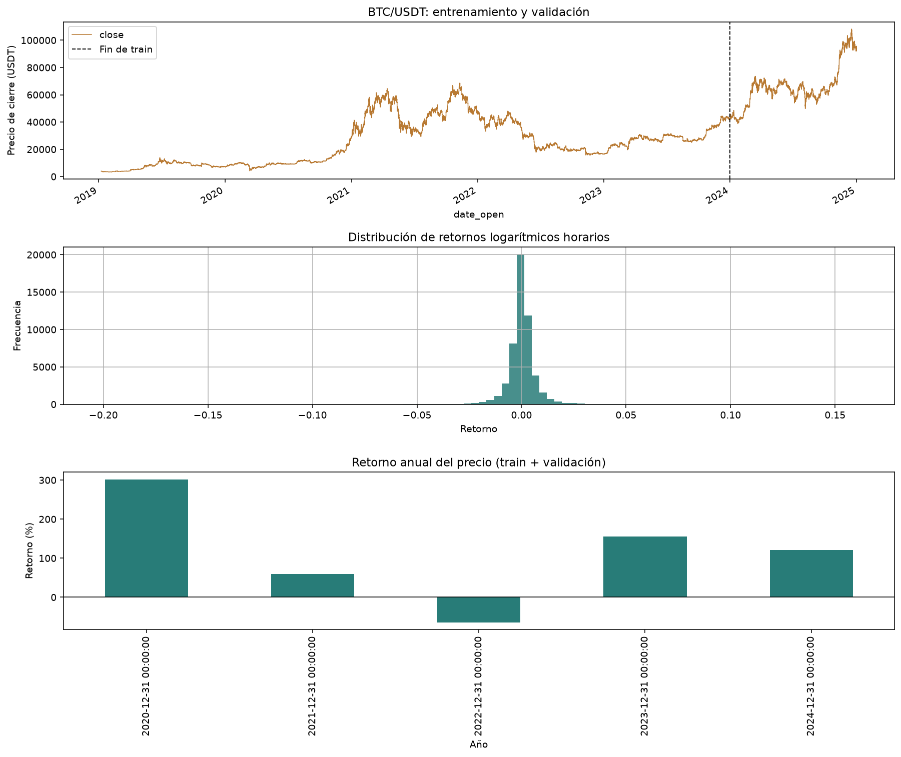
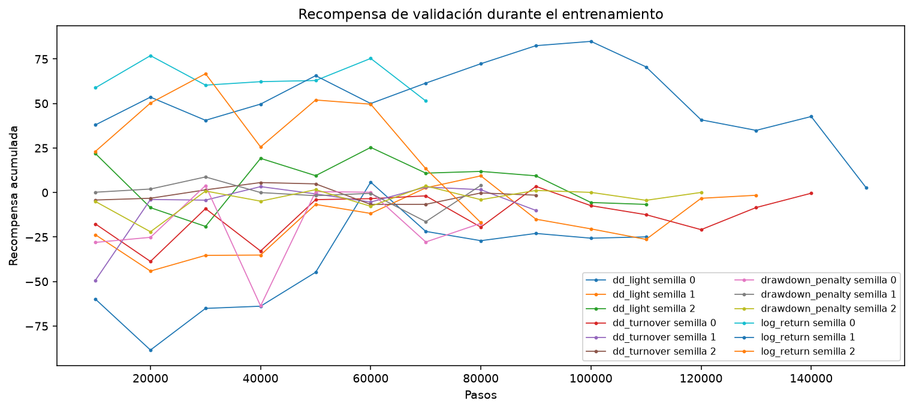
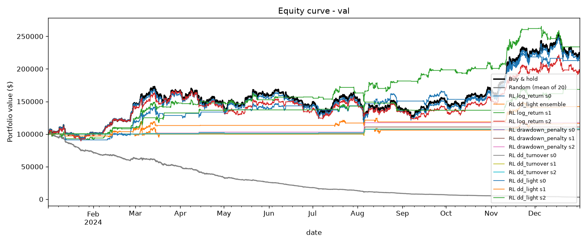
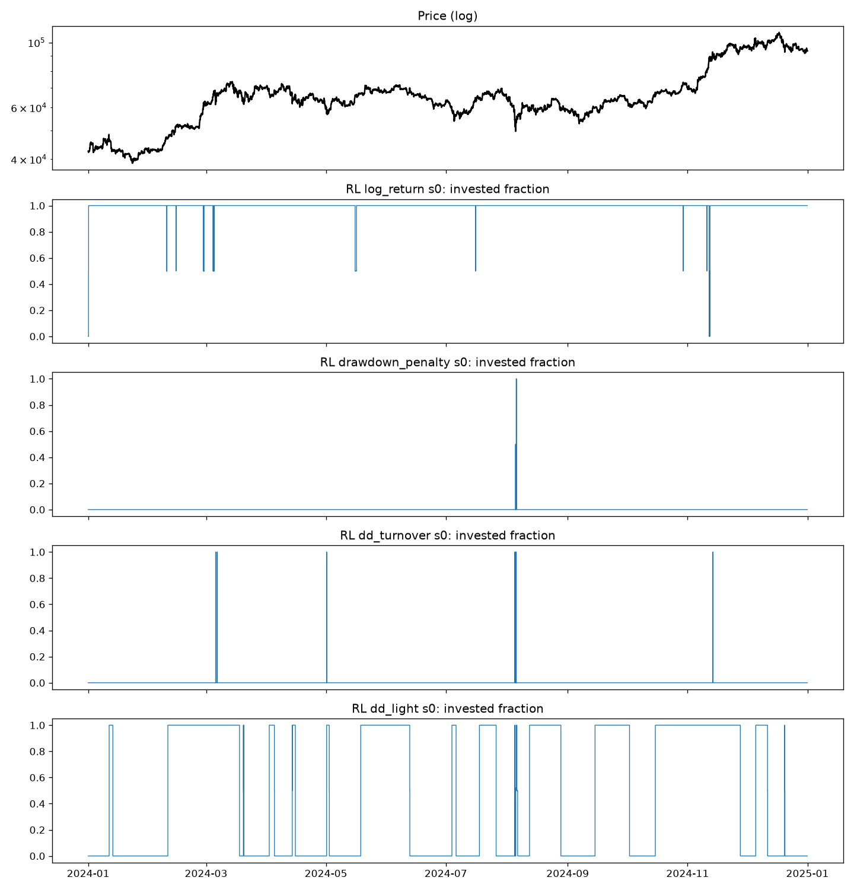
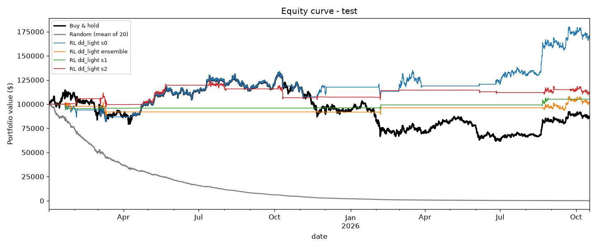
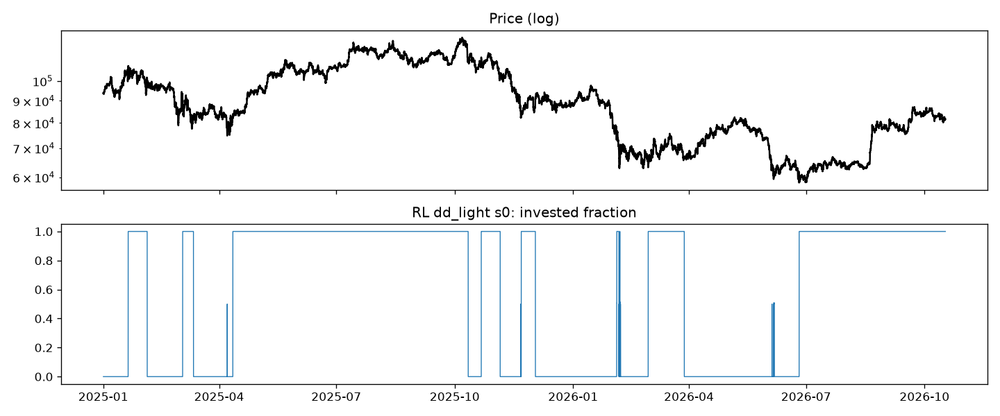
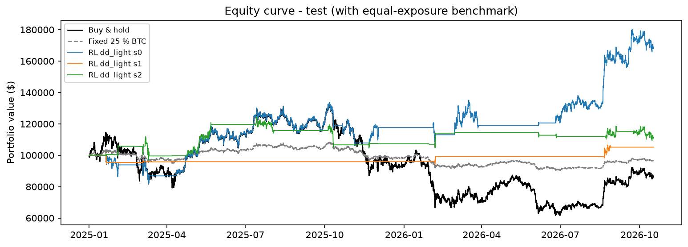

# Bitcoin Sabana Agent RL: evaluación de una estrategia DQN para BTC/USDT

## Resumen
Este trabajo desarrolla y evalúa un agente de aprendizaje por refuerzo profundo basado en Deep Q-Network (DQN) para decidir la exposición a Bitcoin en un portafolio simulado. Se utilizaron velas horarias de BTC/USDT, cuatro funciones de recompensa y tres semillas aleatorias. La selección del modelo se realizó con validación temporal y el conjunto de test se reservó para una evaluación final. En validación, el promedio de semillas de `dd_light` obtuvo 74.51% de retorno acumulado, drawdown máximo de -11.11%, Sharpe de 2.14 y exposición promedio de 23.87%. En el período held-out, el promedio de semillas de `dd_light` obtuvo 28.42% de retorno acumulado, drawdown máximo de -14.36%, Sharpe de 0.65, 40.00 operaciones y exposición promedio de 24.85%. Frente a comprar y mantener, superó el retorno acumulado (28.42% frente a -13.61%) y presentó una magnitud de drawdown menor (-14.36% frente a -53.74%).

**Palabras clave:** aprendizaje por refuerzo, DQN, Bitcoin, gestión de portafolio, drawdown, costos de transacción.

## 1. Introducción
La volatilidad de los criptoactivos hace que una estrategia de inversión deba considerar conjuntamente el retorno, el riesgo de pérdidas y los costos de operación. Comprar y mantener constituye una referencia sencilla, pero mantiene exposición completa durante todo el período. El aprendizaje por refuerzo ofrece una alternativa: un agente observa información de mercado y una posición vigente, y aprende una política de acciones a partir de recompensas definidas sobre la evolución del portafolio.
Este proyecto estudia si un DQN pequeño puede aprender una política de exposición larga a BTC/USDT que resulte útil fuera de muestra. El diseño compara distintas formulaciones de recompensa y controla el uso temporal de los datos para separar el entrenamiento, la selección y la evaluación final.

## 2. Problema y pregunta de investigación
**Problema:** una estrategia basada solo en crecimiento puede operar en exceso o exponerse a caídas pronunciadas; penalizaciones de riesgo mal calibradas también pueden inducir al agente a permanecer en efectivo.
**Pregunta de investigación:** ¿puede un agente DQN entrenado con datos históricos aprender una política de exposición a BTC que ofrezca un balance razonable entre retorno, drawdown y costos al evaluarse en un período temporal no visto?

## 3. Objetivos
### Objetivo general
Diseñar y evaluar un agente DQN para asignar exposición a BTC/USDT, comparando su desempeño y riesgo con estrategias de referencia en períodos de validación y test temporalmente separados.
### Objetivos específicos
- Construir variables de estado retrospectivas y normalizarlas exclusivamente con estadísticas del período de entrenamiento.
- Implementar un entorno de inversión con acciones discretas, capital inicial y costos de transacción explícitos.
- Comparar cuatro funciones de recompensa mediante tres semillas, seleccionando la configuración únicamente con validación.
- Medir retorno acumulado, drawdown máximo, Sharpe, costos, número de operaciones y exposición promedio frente a comprar y mantener y un agente aleatorio.
- Documentar las limitaciones de generalización y sensibilidad a las semillas.

## 4. Justificación y alcance
El experimento permite estudiar de forma reproducible los compromisos entre rentabilidad, riesgo y rotación en una serie financiera horaria. El alcance se limita a BTC/USDT, posiciones largas sin apalancamiento y tres niveles de inversión. Los resultados son evidencia experimental para el período disponible; no constituyen asesoría financiera ni garantizan desempeño futuro.

## 5. Marco conceptual
El aprendizaje por refuerzo modela la interacción entre un agente, un estado, una acción y una recompensa acumulada. DQN aproxima los valores de acción mediante una red neuronal y emplea replay buffer y red objetivo para estabilizar el aprendizaje. En este proyecto, la recompensa combina el retorno logarítmico del portafolio con penalizaciones por profundización del drawdown y cambios de exposición. El Sharpe y el drawdown se reportan como métricas complementarias, no como objetivos optimizados directamente en todos los experimentos.

## 6. Metodología
### 6.1 Datos y partición temporal
Los datos corresponden a velas de una hora de BTC/USDT, obtenidas de Binance mediante el descargador `gym-trading-env`. El archivo utilizado es `data/binance-BTCUSDT-1h.pkl`. Las fechas y cantidades efectivas por partición son:
| particion   | inicio              | fin                 |   velas |
|:------------|:--------------------|:--------------------|--------:|
| train       | 2019-01-08 05:00:00 | 2023-12-31 23:00:00 |   43591 |
| val         | 2024-01-01 00:00:00 | 2024-12-31 23:00:00 |    8784 |
| test        | 2025-01-01 00:00:00 | 2026-10-17 05:00:00 |   15702 |
El período de entrenamiento ajusta el agente y los parámetros de normalización; validación sirve para comparar recompensas y seleccionar checkpoints. Test queda reservado para evaluación final. Las variables se calculan con datos presentes y pasados, y el notebook ejecuta un chequeo automático de lookahead.
### 6.2 Estado, acciones y entorno
El estado contiene seis componentes: `ret_1` (retorno logarítmico horario), `ret_short` (momentum de 24 horas), `ma_gap` (distancia a la media móvil de 168 horas), `volatility` (volatilidad de 24 horas), `rsi` (RSI de 14 períodos reescalado) y la posición actual. Las acciones corresponden a exposiciones 0%, 50%, 100% del capital, con posiciones largas y sin apalancamiento. El capital inicial es $100,000; la comisión es 10 puntos básicos sobre el nominal operado.
### 6.3 Recompensas
Se compararon las siguientes penalizaciones, aplicadas a la recompensa base de retorno logarítmico neto de costos:
| Recompensa       |   Penalización drawdown |   Penalización turnover |
|:-----------------|------------------------:|------------------------:|
| log_return       |                     0   |                   0     |
| drawdown_penalty |                     2   |                   0     |
| dd_turnover      |                     0.5 |                   0.001 |
| dd_light         |                     0.1 |                   0.001 |
Para la configuración final `dd_light`, la forma general empleada es:
$$r_t = 100 × [log(Vₜ₊₁/Vₜ) - 0.1 × ΔDDₜ⁺ - 0.001 × |wₜ - wₜ₋₁|]$$
### 6.4 Entrenamiento y reproducibilidad
Se entrenó un DQN con arquitectura MLP de dos capas ocultas, early stopping por recompensa de validación y semillas 0, 1, 2. Los principales hiperparámetros configurados son:
| Parámetro              | Valor                             |
|:-----------------------|:----------------------------------|
| Arquitectura MLP       | 64 → 64                           |
| Learning rate          | 0.0001                            |
| Batch size             | 64                                |
| Factor de descuento γ  | 0.95                              |
| Replay buffer          | 50000                             |
| Pasos máximos          | 200000                            |
| Evaluación / paciencia | cada 10000 pasos / 5 evaluaciones |
| Longitud de episodio   | 720 horas                         |
| Semillas               | 0, 1, 2                           |
Los checkpoints se seleccionan con validación. El resultado principal por recompensa es el promedio de semillas; el test no interviene en el entrenamiento, la selección de recompensa ni el ajuste de hiperparámetros.
### 6.5 Métricas y comparadores
La evaluación informa retorno acumulado, drawdown máximo, Sharpe anualizado para datos horarios, costos acumulados, número de operaciones y exposición promedio. Los comparadores son comprar y mantener y el promedio de 20 ejecuciones de una política aleatoria. El benchmark de 25% fijo en BTC es descriptivo y no participa en la selección.

## 7. Resultados
### 7.1 Validación
En validación, el promedio de semillas de `dd_light` obtuvo 74.51% de retorno acumulado, drawdown máximo de -11.11%, Sharpe de 2.14 y exposición promedio de 23.87%.
|                                     |   cum_return_% |   max_drawdown_% |   sharpe |   return_over_dd |   costs_$ |   n_trades |   avg_exposure_% |
|:------------------------------------|---------------:|-----------------:|---------:|-----------------:|----------:|-----------:|-----------------:|
| Buy & hold                          |         120.09 |           -32.31 |     1.76 |             3.72 |    100    |       1    |           100    |
| RL log_return s0                    |         115.79 |           -32.38 |     1.73 |             3.58 |   2858.32 |      36    |            99.62 |
| RL dd_light ensemble                |          16.27 |           -13.43 |     0.83 |             1.21 |   2057.46 |      29    |             9.94 |
| RL log_return s1                    |         133.79 |           -14.49 |     2.63 |             9.23 |  27378.2  |     291    |            39.28 |
| RL log_return s2                    |          94.97 |           -27.23 |     1.7  |             3.49 |  34252.5  |     450    |            85.46 |
| RL drawdown_penalty s0              |           7.33 |            -1.24 |     1.48 |             5.93 |    411.26 |       6    |             0.08 |
| RL drawdown_penalty s1              |          10.83 |            -0.31 |     2.04 |            35.01 |    834.7  |      16    |             0.07 |
| RL drawdown_penalty s2              |          17.47 |            -2.94 |     1.92 |             5.93 |   1456.64 |      14    |             0.23 |
| RL dd_turnover s0                   |           6.41 |            -0.88 |     1.29 |             7.32 |   1639.85 |      17    |             0.1  |
| RL dd_turnover s1                   |           7.75 |            -2.94 |     1.05 |             2.63 |    207.83 |       3    |             0.21 |
| RL dd_turnover s2                   |           8.08 |            -0.92 |     2.12 |             8.79 |   1443.96 |      21    |             0.1  |
| RL dd_light s0                      |         112.79 |           -12.21 |     2.31 |             9.24 |   5392.44 |      50    |            44.65 |
| RL dd_light s1                      |          42.12 |           -10.89 |     1.74 |             3.87 |   2641.99 |      34    |            13.9  |
| RL dd_light s2                      |          68.61 |           -10.23 |     2.37 |             6.71 |   5135.58 |      60    |            13.06 |
| Random (mean of 20)                 |         -96.86 |           -96.96 |   -10.03 |            -1    | 114227    |    5870.4  |            50.22 |
| RL log_return (mean of seeds)       |         114.85 |           -24.7  |     2.02 |             5.43 |  21496.4  |     259    |            74.79 |
| RL drawdown_penalty (mean of seeds) |          11.88 |            -1.5  |     1.81 |            15.62 |    900.86 |      12    |             0.13 |
| RL dd_turnover (mean of seeds)      |           7.41 |            -1.58 |     1.49 |             6.25 |   1097.21 |      13.67 |             0.14 |
| RL dd_light (mean of seeds)         |          74.51 |           -11.11 |     2.14 |             6.6  |   4390    |      48    |            23.87 |
### 7.2 Test held-out
En el período held-out, el promedio de semillas de `dd_light` obtuvo 28.42% de retorno acumulado, drawdown máximo de -14.36%, Sharpe de 0.65, 40.00 operaciones y exposición promedio de 24.85%. Frente a comprar y mantener, superó el retorno acumulado (28.42% frente a -13.61%) y presentó una magnitud de drawdown menor (-14.36% frente a -53.74%).
|                             |   cum_return_% |   max_drawdown_% |   sharpe |   return_over_dd |   costs_$ |   n_trades |   avg_exposure_% |
|:----------------------------|---------------:|-----------------:|---------:|-----------------:|----------:|-----------:|-----------------:|
| Buy & hold                  |         -13.61 |           -53.74 |     0.03 |            -0.25 |    100    |        1   |           100    |
| RL dd_light s0              |          68.72 |           -20.59 |     1.11 |             3.34 |   3046.63 |       45   |            57.49 |
| RL dd_light ensemble        |           1.12 |           -14.14 |     0.12 |             0.08 |   1979.76 |       31   |            10.71 |
| RL dd_light s1              |           5.16 |            -6.27 |     0.42 |             0.82 |   1265.67 |       21   |             1.35 |
| RL dd_light s2              |          11.38 |           -16.21 |     0.44 |             0.7  |   3806.28 |       54   |            15.73 |
| Random (mean of 20)         |         -99.91 |           -99.91 |   -13.69 |            -1    | 102399    |    10466.9 |            50.08 |
| RL dd_light (mean of seeds) |          28.42 |           -14.36 |     0.65 |             1.62 |   2706.19 |       40   |            24.85 |
### 7.3 Benchmark descriptivo
|                              |   cum_return_% |   max_drawdown_% |   sharpe |   return_over_dd |   costs_$ |   n_trades |   avg_exposure_% |
|:-----------------------------|---------------:|-----------------:|---------:|-----------------:|----------:|-----------:|-----------------:|
| Buy & hold                   |         -13.61 |           -53.74 |     0.03 |            -0.25 |    100    |        1   |           100    |
| RL dd_light s0               |          68.72 |           -20.59 |     1.11 |             3.34 |   3046.63 |       45   |            57.49 |
| RL dd_light ensemble         |           1.12 |           -14.14 |     0.12 |             0.08 |   1979.76 |       31   |            10.71 |
| RL dd_light s1               |           5.16 |            -6.27 |     0.42 |             0.82 |   1265.67 |       21   |             1.35 |
| RL dd_light s2               |          11.38 |           -16.21 |     0.44 |             0.7  |   3806.28 |       54   |            15.73 |
| Random (mean of 20)          |         -99.91 |           -99.91 |   -13.69 |            -1    | 102399    |    10466.9 |            50.08 |
| RL dd_light (mean of seeds)  |          28.42 |           -14.36 |     0.65 |             1.62 |   2706.19 |       40   |            24.85 |
| Fixed 25 % BTC (descriptive) |          -3.4  |           -16.54 |    -0.12 |            -0.21 |     25    |        1   |            23.79 |
### 7.4 Figuras
### Análisis exploratorio (train + validación)

### Curvas de entrenamiento

### Curvas de capital en validación

### Posiciones del agente en validación

### Curvas de capital en test held-out

### Posiciones del agente en test held-out

### Comparación con benchmark de exposición fija

## 8. Discusión
En validación, el promedio de semillas de `dd_light` obtuvo 74.51% de retorno acumulado, drawdown máximo de -11.11%, Sharpe de 2.14 y exposición promedio de 23.87%. En el período held-out, el promedio de semillas de `dd_light` obtuvo 28.42% de retorno acumulado, drawdown máximo de -14.36%, Sharpe de 0.65, 40.00 operaciones y exposición promedio de 24.85%. Frente a comprar y mantener, superó el retorno acumulado (28.42% frente a -13.61%) y presentó una magnitud de drawdown menor (-14.36% frente a -53.74%).
La sensibilidad a la semilla es relevante: el retorno individual de las semillas varió entre 5.16% y 68.72%.
La comparación debe interpretarse considerando que los regímenes de mercado pueden diferir entre validación y test, y que el promedio de pocas semillas puede ocultar variabilidad importante. El benchmark de exposición fija aporta contexto sobre el efecto de invertir parcialmente, pero no sustituye una evaluación con más períodos y activos.

## 9. Conclusiones
1. El proyecto implementa un flujo reproducible de DQN para asignación discreta de exposición a BTC y explicita costos, selección temporal y métricas de riesgo. En validación, el promedio de semillas de `dd_light` obtuvo 74.51% de retorno acumulado, drawdown máximo de -11.11%, Sharpe de 2.14 y exposición promedio de 23.87%.
2. En el período held-out, el promedio de semillas de `dd_light` obtuvo 28.42% de retorno acumulado, drawdown máximo de -14.36%, Sharpe de 0.65, 40.00 operaciones y exposición promedio de 24.85%. Frente a comprar y mantener, superó el retorno acumulado (28.42% frente a -13.61%) y presentó una magnitud de drawdown menor (-14.36% frente a -53.74%).
3. Estos resultados responden la pregunta de investigación de forma condicionada al activo, período, costos y semillas evaluados; la sensibilidad a la semilla es relevante: el retorno individual de las semillas varió entre 5.16% y 68.72%.
4. En consecuencia, el agente debe considerarse un prototipo experimental y no una recomendación de inversión.

## 10. Limitaciones y trabajo futuro
- La evaluación se limita a un activo y un único período held-out; no permite inferir robustez en otros regímenes o mercados.
- Tres semillas ofrecen una caracterización inicial, pero no bastan para establecer significancia estadística; conviene reportar intervalos de confianza y ampliar las semillas.
- El backtest no modela todos los elementos de ejecución real, como deslizamiento, latencia, liquidez variable, impuestos o restricciones operativas.
- Como trabajo futuro se propone evaluar ventanas walk-forward, más activos y períodos, costos y deslizamientos alternativos, y pruebas de sensibilidad de hiperparámetros definidas sin consultar test.

## 11. Reproducibilidad y archivos
La configuración está en `configs/default.yaml`; los módulos de datos, entorno, agente, entrenamiento y evaluación están en `src/`. La ejecución se realizó con los artefactos que actualmente existen en `models/` y `results/`. Fecha de generación del informe: 2026-10-17.

## Referencias
Mnih, V. et al. (2015). Human-level control through deep reinforcement learning. *Nature, 518*, 529–533. https://doi.org/10.1038/nature14236
Sutton, R. S., & Barto, A. G. (2018). *Reinforcement Learning: An Introduction* (2.ª ed.). MIT Press.
Binance. Datos históricos de mercado BTC/USDT en velas de una hora; descargados según la configuración del proyecto.

---
